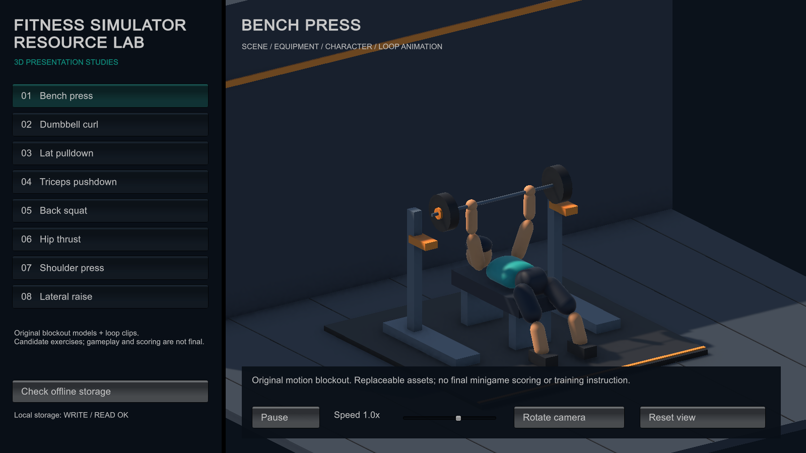

# [FRAME] 健身模拟器 / Fitness Simulator

[FRAME｜当前协作入口] 先读[本地协作规则](AGENTS.md)和[唯一批次待办／验收清单](TODOLIST.md)。当前任务状态以清单为准，下方阶段记录保留为历史。默认在Unity打开`Assets/FitnessSimulator/Scenes/Player/GameBootstrap.unity`查看成果；构建命令仅作能力参考，只有用户明确要求本次出包才执行。

[COMPUTED｜HIGH] **最新交付：M3R1七项体验修改**。餐食分餐记忆与直接反馈、晚间计划编辑、固定主菜单、删除字号／当天安排、半日工作发薪、确认右置及训练锚点选择已接入；67/67针对测试、10张布局图与严格安卓构建通过。[安装包](Builds/M3R1/Android/FitnessSimulator-M3R1.apk)及[完整交付记录](Docs/Implementation/M3Revision1.md)。原M3及下方路线记录为此前基线，不认证新收入规则的长线平衡。本轮已停止。

[COMPUTED｜HIGH] 当前推进文本首版M2/M3无人验收：8种真实输入核、人物世界屏障、生活与关系、比赛及结局已接入正式应用。两类自然冠军到D43、两类实际非冠军、双弃赛、从未报名、D50/D84续届、双报名三种组合及D86自然恋爱成功/续玩已有对应运行证据；恋爱后的参赛和零出场义务也已实际通过。原路线未达目标的失败记录保留。隔离D84有一项编辑器生成的URP缓存列表漂移，仅签业务逻辑。具体边界与当前运行见[M2/M3实施记录](Docs/Implementation/M2Implementation.md)及[验证记录](Docs/Verification.md)，不等于全部首版验收。[M1实施记录](Docs/Implementation/M1Implementation.md)保留旧包证据，M3开发安装包已构建并完成签名/清单核验，交付见[M3验收摘要](Docs/Implementation/M3VerificationSummary.md)。本轮收口停止，不扩范围。历史3D训练资源实验场继续隔离。

[FRAME｜当前首版] 安卓横屏、纯离线、文本优先完整游戏。卧推、哑铃弯举、高位下拉、绳索下压、深蹲、臀推、肩推、侧平举8种独立真实小游戏均在首版范围；复杂3D、美术与器械动画后置。当前3D资源实验场是历史原型，不是正式首版入口。

[FRAME｜实施入口] 先读[统一技术方案与实施任务](Docs/Technical/FirstReleaseTechnicalPlan.md)、[程序模块分工与工程证据](Docs/ProgramModulesAndDependencies.md)及[集成审查](Docs/Technical/IntegrationReview.md)。M0方案阶段已完成；后续用户授权实际开发，现从M1按阶段实施，不能将方案、领域测试或构建通过等同全部首版验收。

## [FRAME] 正式文本切片

[COMPUTED｜HIGH] 正式场景为 `Assets/FitnessSimulator/Scenes/Player/GameBootstrap.unity`，源码位于 `Assets/FitnessSimulator/Production`。打开正式场景后运行；首次新局使用稳步新手与明确的卧推自定义计划，之后从主菜单继续。单独保存于应用持久目录的 `PlayerM1`，不读取旧实验场存档。

```powershell
powershell -NoProfile -File Tools/Game.ps1 -Action import
powershell -NoProfile -File Tools/Game.ps1 -Action test
powershell -NoProfile -File Tools/Game.ps1 -Action ui-smoke
powershell -NoProfile -File Tools/Game.ps1 -Action build-android
powershell -NoProfile -File Tools/Game.ps1 -Action build-proxy
```

[FRAME] 测试按[现行轻量验证流程](Docs/Verification.md)执行：不复制源码、不重复封存；默认限制追踪、快照和运行证据体积。正式验收先提交变更，再给测试命令加 `-RequireCleanSource`。未提交工作区仅生成自测证据。

[FRAME] 命令由同一进程锁串行运行。图形烟测使用实际界面和隔离测试存档，属于桌面脚本重放，不是安卓触摸。正式构建目标目录是 `Builds/M1`；是否实际生成成功以[最新验证证据](Docs/Verification.md)为准。



## [FRAME] 运行现有实验场

[COMPUTED｜HIGH] 固定编辑器版本为 Unity `6000.6.1f1`，使用 URP；版本与包锁文件随工程保存。通过 Unity Hub 添加此目录，打开 `Assets/FitnessSimulator/Scenes/Bootstrap.unity`，点击 Play。界面支持切换动作、暂停、播放速度、旋转镜头及本机存储自检。

```powershell
# 在项目根目录运行；编辑器需关闭本工程才能执行批处理。
powershell -NoProfile -File Tools/Environment.ps1
powershell -NoProfile -File Tools/Unity.ps1 -Action validate
powershell -NoProfile -File Tools/Unity.ps1 -Action test
powershell -NoProfile -File Tools/Unity.ps1 -Action build-windows
powershell -NoProfile -File Tools/Unity.ps1 -Action smoke -ShowWindow
powershell -NoProfile -File Tools/Unity.ps1 -Action build-android
```

[FRAME] 新环境需要安装相同编辑器及 Android Build Support、SDK/NDK、OpenJDK。脚本默认读取标准 Hub 安装路径，可通过 `-EditorPath` 指定其他位置。首次包解析/构建可能访问依赖仓库；游戏本身按离线要求设计。

[COMPUTED｜HIGH] Windows 输出为 `Builds/Windows/FitnessSimulator.exe`；Android 输出为 `Builds/Android/FitnessSimulator.apk`，ARM64、最低 Android API 26，开发阶段默认调试签名。正式发布签名与商店配置尚未设置。

[FRAME] `-Action setup` 会重新生成 `Generated` 资产和场景，请将正式手工资源放在独立目录。日常打开、测试和构建不需要重跑 setup。

[COMPUTED｜HIGH] 画面验证需 `-ShowWindow`，期间会显示原型窗口并依次切换动作，完成后退出；隐藏窗口虽可推进动画与读写存储，但本机驱动返回黑色截图。脚本会拒绝 8 张相同截图，画面仍需人工检查。

## [FRAME] 文档

- [FRAME] [现行架构与协议入口](Docs/Architecture.md)
- [FRAME] [统一技术方案、实施顺序和剩余门槛](Docs/Technical/FirstReleaseTechnicalPlan.md)
- [FRAME] [程序模块职责、实际工程证据与S/AC覆盖](Docs/ProgramModulesAndDependencies.md)
- [FRAME] [逐动作模型、动画、场景参考及资源许可记录](Docs/TrainingResources.md)
- [FRAME] [环境和验证记录](Docs/Verification.md)
- [FRAME] [清理记录与研发入口](Docs/Development.md)

[FRAME] `Library`、`Builds`、`Logs`、`TestResults` 等缓存和产物不进版本控制；提交 `Assets` 连同 `.meta`、`Packages`、`ProjectSettings`、源码及文档。原型资产采用仓库现有许可证；第三方包遵循各自许可证。

[FRAME] 旧版README已保留于[审计归档](Docs/Audit/README.before-2026-10-23-review.md)，仅供追溯；当前执行基线以以上现行方案和产品主文档为准。

[RULES I BROKE]: 无。
